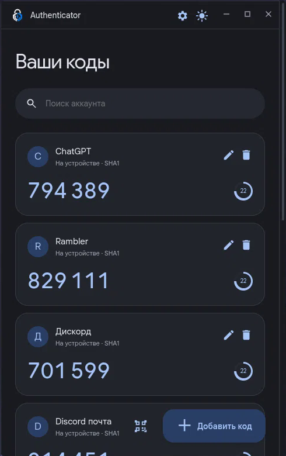
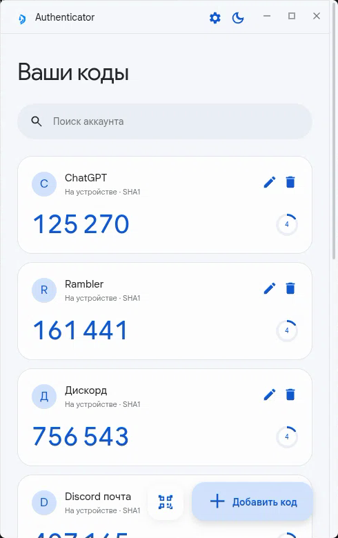
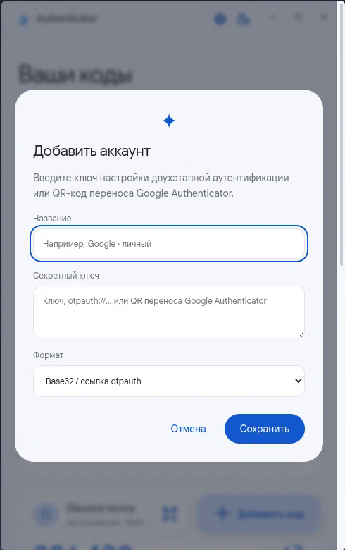
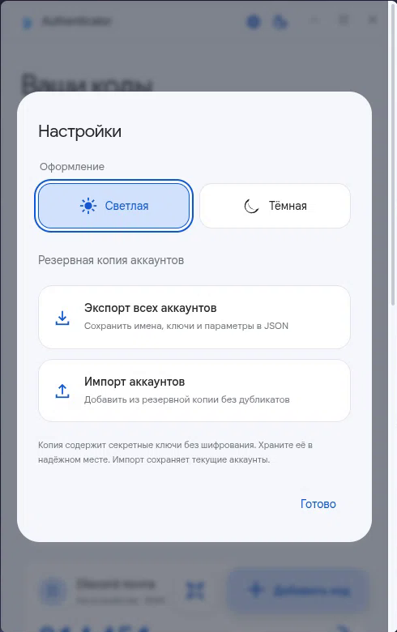

# Authenticator

[](LICENSE) [](#установка) [](https://www.electronjs.org/) [](https://nodejs.org/) [](#проверка)

Приложение для двухэтапной аутентификации: локальная генерация TOTP-кодов,
интерфейс в стиле Material Design 3, светлая и тёмная темы. Работает на Linux,
Windows и Android — интерфейс и логика общие для всех платформ.

**Секретные ключи не покидают вашу машину.** Приложение не является продуктом Google.

---

## Скриншоты

| Тёмная тема | Светлая тема |
| :---: | :---: |
|  |  |

| Добавление аккаунта | Настройки |
| :---: | :---: |
|  |  |

## Возможности

- **Локальный TOTP** — SHA1, SHA256, SHA512; 6 или 8 цифр; период из QR-кода. Коды считаются на машине, сеть для генерации не используется.
- **Гибкий ввод ключей** — Base32, Base64 (сырые байты ключа либо закодированный текст) и ссылки `otpauth://totp`.
- **Перенос из Google Authenticator** — формат `otpauth-migration://` распознаётся кнопкой QR или вставкой текста. Подробнее [ниже](#перенос-аккаунтов-из-google-authenticator).
- **Сканирование QR с экрана** — кнопка слева от «Добавить код». Выделение области как в скриншотере: рамка принимается отпусканием мыши, `Esc` отменяет. Снимок живёт только в памяти и удаляется сразу после распознавания.
- **Управление аккаунтами** — поиск, переименование, удаление, копирование кода в буфер одним нажатием.
- **Резервные копии** — экспорт и импорт всех аккаунтов в JSON. Импорт проверяет файл целиком до сохранения и пропускает дубликаты; ошибка в любом аккаунте отменяет весь импорт.
- **Оформление** — светлая и тёмная темы, кастомный минималистичный скроллбар в цвет темы, собственные элементы управления окном.

## Безопасность и приватность

Это приложение для двухфакторной аутентификации, поэтому о хранении ключей стоит знать заранее.

- Ключи хранятся **без шифрования** в `accounts.json` в системном каталоге `userData`, с правами файла `0600` на Linux и macOS. Системное хранилище (GNOME Keyring, KWallet) не требуется.
- Каталог с данными:
  - Linux: `~/.config/material-authenticator/`
  - Windows: `%APPDATA%\material-authenticator\`
  - macOS: `~/Library/Application Support/material-authenticator/`
- **Секреты не передаются в renderer-процесс.** Интерфейс получает только готовые коды и метаданные; сами ключи остаются в главном процессе Electron.
- Сетевые запросы для генерации кодов отсутствуют. Приложение не отправляет телеметрию.
- Экспортированная резервная копия **не зашифрована** — храните её в надёжном месте.
- Резервные копии и `accounts.json` внесены в `.gitignore`, чтобы ключи случайно не попали в репозиторий.
- Прежний зашифрованный файл `accounts.enc` автоматически переносится, если его удаётся расшифровать, и сохраняется для восстановления.

## Установка

### Готовые сборки

Скачайте подходящий файл со [страницы релизов](../../releases):

- **Linux** — `Authenticator-1.0.0-linux-x86_64.AppImage`:
  ```sh
  chmod +x Authenticator-1.0.0-linux-x86_64.AppImage
  ./Authenticator-1.0.0-linux-x86_64.AppImage
  ```
  Если в системе нет FUSE: `./Authenticator-1.0.0-linux-x86_64.AppImage --appimage-extract-and-run`

- **Windows** — установщик `Authenticator-1.0.0-windows-x64-setup.exe`.

- **Android** — `Authenticator-1.0.0.apk` (Android 7.0+, WebView). Установка:
  ```sh
  adb install -r Authenticator-1.0.0.apk
  ```
  Или скопируйте файл на телефон и откройте его. Сборка подписана отладочным
  ключом, поэтому система предупредит об неизвестном источнике.

Сборки не подписаны, поэтому система может предупредить о неизвестном издателе.

### Arch Linux

В каталоге [`packaging/arch`](packaging/arch) лежит `PKGBUILD` для установки в систему:

```sh
cd packaging/arch
makepkg -si
```

Установленные файлы размещаются в `/opt/material-authenticator`, ярлык появляется в меню приложений. При удалении пакета ваши ключи сохраняются.

### Из исходников

Требуется **Node.js 22+**.

```sh
git clone https://github.com/NettixDev-ctrl/Authenticator.git
cd material-authenticator
npm install
npm start
```

Если Electron уже установлен в системе, запуск использует его в отсутствие npm-пакета. Для распознавания QR нужен `jsqr` из `npm install` либо встроенный `BarcodeDetector`, если платформа его поддерживает.

### Android

Electron не поддерживает Android, поэтому мобильная версия — это WebView-обёртка
над тем же интерфейсом (каталог [`android`](android)). Переиспользуется всё:
`public/` подключается напрямую, `android/src/otp.js` — тот же TOTP, но на чистом
JS, так как в WebView нет `node:crypto`.

Требуется **Android SDK** (build-tools 34.0.0, platforms/android-34) и **JDK 17**:

```sh
sudo pacman -S jdk17-openjdk                       # JDK 17: d8 несовместим с JDK 27
export ANDROID_HOME="$HOME/android-sdk"            # или свой путь к SDK
cd android
./build.sh                                         # → Authenticator-1.0.0.apk
```

Сборка не требует Gradle: `aapt2` + `javac` + `d8` + `apksigner`. Отладочный ключ
подписи создаётся автоматически при первой сборке и в репозиторий не попадает.

Отличия мобильной версии: QR снимается камерой (нативный интент вместо захвата
экрана), коды копируются в системный буфер, резервные копии сохраняются в
«Загрузки». Управление окном скрыто — на телефоне его нет.

## Перенос аккаунтов из Google Authenticator

Приложение читает QR-код «Экспорт аккаунтов» из Google Authenticator.

1. В Google Authenticator на телефоне откройте **«Перенос аккаунтов» → «Экспорт аккаунтов»** и выберите аккаунты.
2. В этом приложении нажмите кнопку **QR** слева от «Добавить код»:
   - на телефоне откроется камера — наведите её на QR-код;
   - на компьютере выделите QR-код на экране, как в скриншотере: рамка принимается отпусканием мыши, `Esc` отменяет.
     На KDE/Wayland используется системное выделение Spectacle (пакет `spectacle`).
3. Аккаунты добавятся списком — названия и параметры подтянутся из кода.

Если аккаунтов много, Google показывает несколько QR-кодов по очереди: отсканируйте каждый, **дубликаты пропустятся автоматически**. Вместо сканирования можно скопировать ссылку `otpauth-migration://` целиком в поле «Секретный ключ» — название при этом вводить не нужно.

Аккаунты **HOTP** и **MD5** не поддерживаются: приложение сообщит, какой именно аккаунт пропущен, и не выполнит импорт вслепую.

## Управление

| Действие | Как |
| --- | --- |
| Скопировать код | Нажать на сам код |
| Поиск | Поле «Поиск аккаунта» |
| Переименовать / удалить | Кнопки на карточке аккаунта |
| Сканировать QR | Кнопка QR слева от «Добавить код»: камера на телефоне, выделение области на компьютере |
| Сменить тему | Кнопка солнца/луны в заголовке или в настройках |
| Настройки и резервные копии | Кнопка шестерёнки |
| Отменить выделение области | `Esc` (только на компьютере) |

## Сборка

```sh
npm install
npm run build:linux   # AppImage (x64)
npm run build:win     # установщик NSIS (x64)
npm run build:all     # обе платформы
```

electron-builder скачивает инструменты упаковки и Electron для нужной платформы, поэтому при первой сборке нужен интернет. Результат складывается в `dist`. В Windows-сборке редактирование PE через Wine отключено: установщик и интерфейс используют собственный логотип, но в Проводнике может отображаться стандартная иконка Electron.

## Проверка

```sh
npm test                  # настольная версия: 13 тестов
cd android && npm test    # Android: 9 тестов
```

Тесты на встроенном `node:test` покрывают официальные векторы **RFC 6238**, разбор параметров QR, кодирование Base32/Base64, декодирование формата переноса Google Authenticator и отклонение недопустимых параметров (включая HOTP и MD5).

Тесты Android запускают **тот самый скрипт, который лежит внутри APK**: он собирается
той же склейкой, что и в `build.sh`, и выполняется в окружении с заглушками WebView.
Проверяются совместимость с API настольной версии, хранение в `localStorage`,
перенос аккаунтов, экспорт и импорт резервных копий и сохранность данных.

## Структура проекта

```
main.cjs               главный процесс Electron: окно, IPC, хранение аккаунтов, захват QR
preload.cjs            contextBridge для основного окна
capture-preload.cjs    contextBridge для окна выделения области
otp.js                 TOTP (RFC 6238), Base32/Base64, разбор otpauth:// и otpauth-migration://
backup.js              экспорт и импорт JSON-резервных копий
launch.cjs             запуск Electron
public/                интерфейс: index.html, style.css, app.js, capture.*, assets, fonts
test/                  тесты (otp, backup, migration)
build/                 иконки приложения
packaging/arch/        PKGBUILD для Arch Linux
docs/screenshots/      скриншоты для документации
android/               сборка для Android
  build.sh               сборка APK без Gradle
  MainActivity.java      WebView, камера, буфер обмена, сохранение файлов
  src/otp.js             TOTP на чистом JS (в WebView нет node:crypto)
  src/bridge.js          замена preload.cjs: localStorage вместо IPC
  web/android.css        мобильные правки интерфейса
  vendor/jsQR.js         распознавание QR (резервная копия для сборки без npm install)
  res/                   иконки и ресурсы Android
  test/                  тесты моста
```

## Лицензии третьих сторон

- **Electron** — лицензия MIT, текст в `LICENSE.electron.txt` (входит в сборку).
- **Chromium** — сторонние лицензии в `LICENSES.chromium.html` (входит в сборку).
- **jsQR** — лицензия Apache-2.0.
- **Google Sans** — поставляется локально в `public/fonts` по лицензии SIL Open Font License 1.1, текст в `public/fonts/OFL.txt`.
- **Google, Google Authenticator, Google Sans** — товарные знаки Google LLC. Это приложение не связано с Google и не одобрено ею.

## Лицензия

[MIT](LICENSE) © 2026 NettixDev
